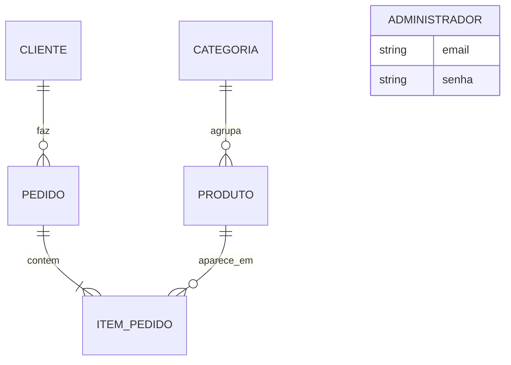

# Projeto do banco de dados

SGBD escolhido: **PostgreSQL 16** — gratuito, amplamente usado no mercado, com suporte a tipos `ENUM`, `NUMERIC` exato e restrições `CHECK`.

## 1. Projeto conceitual



- Uma **categoria** agrupa vários produtos; cada produto pertence a uma categoria.
- Um **cliente** pode fazer vários pedidos; cada pedido é de um cliente.
- Um **pedido** tem um ou mais itens; cada **item** se refere a um produto.
- O **administrador** é independente (não se relaciona com as demais entidades).

## 2. Projeto lógico (normalizado)

```
categorias      (id PK, nome UNIQUE)
produtos        (id PK, nome, descricao, produtor, unidade, preco, estoque, icone, ativo, categoria_id FK→categorias)
clientes        (id PK, nome, email UNIQUE, telefone)
pedidos         (id PK, codigo UNIQUE, cliente_id FK→clientes, criado_em, estado, endereco, cidade, cep, subtotal, frete, total)
itens_pedido    (id PK, pedido_id FK→pedidos, produto_id FK→produtos, quantidade, preco_unitario, subtotal)
administradores (id PK, email UNIQUE, senha_hash)
```

**Verificação das formas normais**

- **1FN** — todos os atributos são atômicos; os itens do pedido ficam numa tabela própria, não numa lista dentro do pedido.
- **2FN** — todas as tabelas têm chave primária simples (`id`), então não há dependência parcial.
- **3FN** — o nome da categoria fica em `categorias`, não repetido em cada produto; os dados do cliente ficam em `clientes`, não repetidos em cada pedido.

**Desnormalizações intencionais**

| Campo | Justificativa |
|---|---|
| `itens_pedido.preco_unitario` | Registra o preço **no momento da compra**. Se o preço do produto mudar depois, o histórico do pedido não pode mudar. |
| `itens_pedido.subtotal`, `pedidos.subtotal/frete/total` | Valores fechados do pedido, usados como comprovante. Evitam recalcular com regras de frete que podem mudar. |
| `pedidos.endereco/cidade/cep` | O endereço é do pedido, não do cliente: a mesma pessoa pode receber em lugares diferentes. |

## 3. Projeto físico

O script completo está em [`database/schema.sql`](../../database/schema.sql). Ele é **gerado a partir dos models** (`python -m scripts.gerar_schema_sql`), garantindo que a documentação e o código nunca fiquem diferentes.

Principais decisões:
- `NUMERIC(10,2)` para dinheiro (sem erros de arredondamento de `float`).
- `TIMESTAMP WITH TIME ZONE` para a data do pedido.
- Tipo `ENUM estado_pedido` restringe os estados possíveis no próprio banco.
- `CHECK (preco > 0)` e `CHECK (estoque >= 0)` em `produtos`.
- Índices únicos em `clientes.email` e `pedidos.codigo` (buscas frequentes).
- `ON DELETE CASCADE` de `pedidos` para `itens_pedido`.

## 4. Dicionário de dados

### categorias

| Coluna | Tipo | Nulo | Chave | Descrição |
|---|---|---|---|---|
| id | SERIAL | não | PK | Identificador |
| nome | VARCHAR(60) | não | UNIQUE | Nome da categoria (ex.: Hortifrúti) |

### produtos

| Coluna | Tipo | Nulo | Chave | Descrição |
|---|---|---|---|---|
| id | SERIAL | não | PK | Identificador |
| nome | VARCHAR(100) | não | | Nome exibido no catálogo |
| descricao | TEXT | não | | Descrição curta |
| produtor | VARCHAR(100) | não | | Sítio/fazenda de origem |
| unidade | VARCHAR(20) | não | | Unidade de venda (kg, dúzia, 500 g…) |
| preco | NUMERIC(10,2) | não | | Preço por unidade, em reais. `CHECK > 0` |
| estoque | INTEGER | não | | Unidades disponíveis. `CHECK >= 0` |
| icone | VARCHAR(10) | não | | Emoji ilustrativo |
| ativo | BOOLEAN | não | | Se aparece no catálogo |
| categoria_id | INTEGER | não | FK → categorias.id | Categoria do produto |

### clientes

| Coluna | Tipo | Nulo | Chave | Descrição |
|---|---|---|---|---|
| id | SERIAL | não | PK | Identificador |
| nome | VARCHAR(120) | não | | Nome completo |
| email | VARCHAR(160) | não | UNIQUE | E-mail em minúsculas; identifica o cliente |
| telefone | VARCHAR(30) | não | | Telefone com DDD |

### pedidos

| Coluna | Tipo | Nulo | Chave | Descrição |
|---|---|---|---|---|
| id | SERIAL | não | PK | Identificador interno |
| codigo | VARCHAR(12) | não | UNIQUE | Código público (ex.: ML-4F2A9C) |
| cliente_id | INTEGER | não | FK → clientes.id | Quem fez o pedido |
| criado_em | TIMESTAMPTZ | não | | Data e hora do pedido (padrão `now()`) |
| estado | estado_pedido | não | | Recebido, Em preparação, Saiu para entrega, Entregue ou Cancelado |
| endereco | VARCHAR(200) | não | | Rua, número e complemento |
| cidade | VARCHAR(80) | não | | Cidade de entrega |
| cep | VARCHAR(9) | não | | CEP no formato 00000-000 |
| subtotal | NUMERIC(10,2) | não | | Soma dos itens |
| frete | NUMERIC(10,2) | não | | Valor do frete cobrado |
| total | NUMERIC(10,2) | não | | subtotal + frete |

### itens_pedido

| Coluna | Tipo | Nulo | Chave | Descrição |
|---|---|---|---|---|
| id | SERIAL | não | PK | Identificador |
| pedido_id | INTEGER | não | FK → pedidos.id (CASCADE) | Pedido ao qual pertence |
| produto_id | INTEGER | não | FK → produtos.id | Produto comprado |
| quantidade | INTEGER | não | | Quantidade comprada (1 a 50) |
| preco_unitario | NUMERIC(10,2) | não | | Preço do produto no momento da compra |
| subtotal | NUMERIC(10,2) | não | | quantidade × preco_unitario |

### administradores

| Coluna | Tipo | Nulo | Chave | Descrição |
|---|---|---|---|---|
| id | SERIAL | não | PK | Identificador |
| email | VARCHAR(160) | não | UNIQUE | Login |
| senha_hash | VARCHAR(200) | não | | Hash PBKDF2-SHA256 com sal (`algoritmo$iterações$sal$hash`) |
