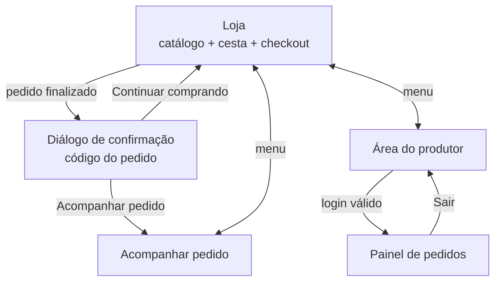

# Interface Humano-Computador

## Mapa de navegação

## Telas

| Tela | Rota | Objetivo | Elementos principais |
|---|---|---|---|
| Loja | `/` | Escolher produtos e fechar o pedido numa única página | Destaque com a regra do frete, busca, filtros por categoria, cards de produto, cesta fixa na lateral com resumo de valores e formulário de entrega |
| Confirmação | diálogo em `/` | Dar segurança de que o pedido foi recebido | Código do pedido em destaque, total, atalho para acompanhar |
| Acompanhar pedido | `/acompanhar` | Saber em que etapa está a entrega | Campo de código, linha do tempo das etapas, itens e valores |
| Área do produtor | `/admin` | Gerenciar os pedidos do dia | Login; tabela de pedidos com filtro por estado e seletor de próximo estado |

As capturas de tela das versões finais ficam em [`docs/situacao-2/telas/`](../situacao-2/telas/).

## Decisões de usabilidade

- **Checkout na mesma página da cesta**: elimina etapas e reduz o abandono de carrinho.
- **Sem cadastro obrigatório**: o cliente é identificado pelo e-mail; menos atrito na primeira compra.
- **Regra do frete visível desde o início**, e o resumo da cesta mostra "Grátis" quando atingida, incentivando o cliente a completar o valor.
- **Botão "Adicionar" desativado** e indicação "Esgotado" quando o produto não tem estoque.
- **Máscara automática de CEP** (00000-000).
- **Seletor de estado mostra só as transições permitidas**, evitando erros do administrador.
- **Cores e contraste**: verde (natureza, confiança) e terracota (ação). Textos em contraste mínimo de 4.5:1.
- **Mobile first**: a cesta passa para baixo do catálogo em telas menores que 900 px.
- **Acessibilidade**: botões com `aria-label`, avisos em região `aria-live`, foco visível nos campos.

## Mensagens do sistema

| Situação | Mensagem | Onde aparece |
|---|---|---|
| Cesta vazia ao finalizar | Adicione pelo menos um produto à cesta. | Abaixo do formulário |
| Campo obrigatório vazio | Mensagem nativa do navegador no próprio campo | No campo |
| E-mail inválido | E-mail: e-mail inválido | Abaixo do formulário |
| Campo curto demais | Endereço: muito curto (mínimo 5 caracteres) | Abaixo do formulário |
| CEP inválido | CEP: CEP deve ter 8 dígitos | Abaixo do formulário |
| Estoque insuficiente | Estoque insuficiente para *Produto* (disponível: *N*). | Abaixo do formulário |
| Limite de estoque na cesta | Só temos *N* unidade(s) de *Produto*. | Aviso flutuante |
| Produto adicionado | *Produto* adicionado à cesta. | Aviso flutuante |
| Falha de rede/servidor | Erro inesperado (*código*). Tente novamente. | Abaixo do formulário |
| Código de pedido inexistente | Pedido não encontrado. | Página de acompanhamento |
| Login inválido | E-mail ou senha inválidos. | Formulário de login |
| Transição de estado proibida | Não é possível mudar de '*A*' para '*B*'. | Aviso flutuante |

## Protótipo

O protótipo do PIT I foi substituído pela própria interface implementada, que é o protótipo de alta fidelidade desta versão. Mudanças em relação ao protótipo original estão em [melhorias-em-relacao-ao-pit-1.md](melhorias-em-relacao-ao-pit-1.md).
