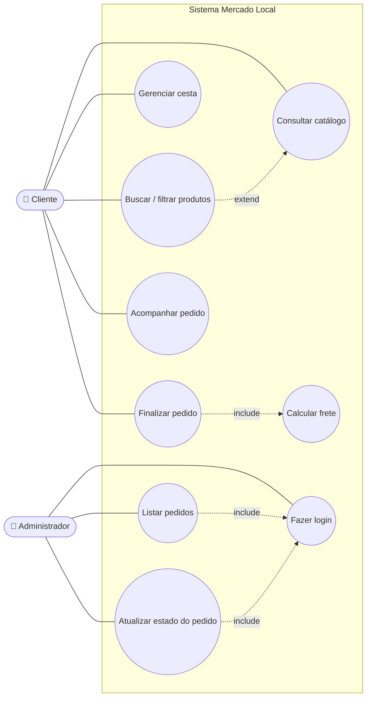
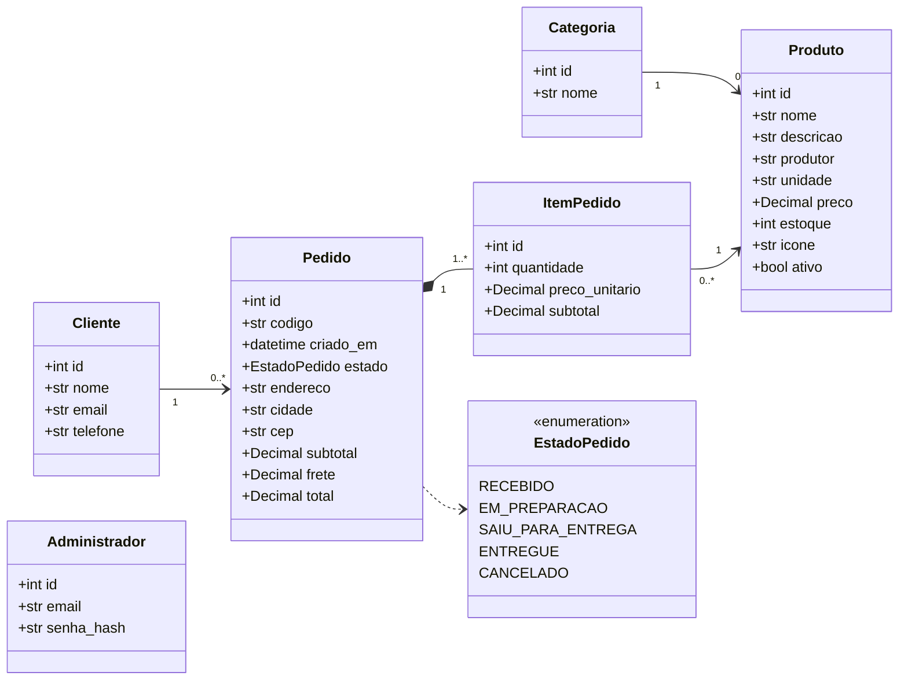
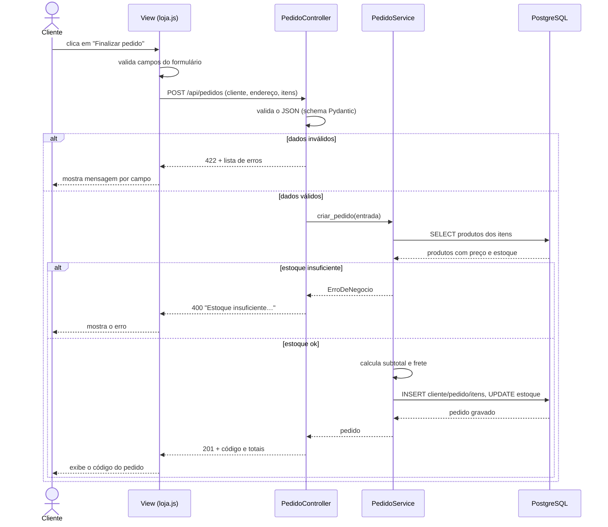
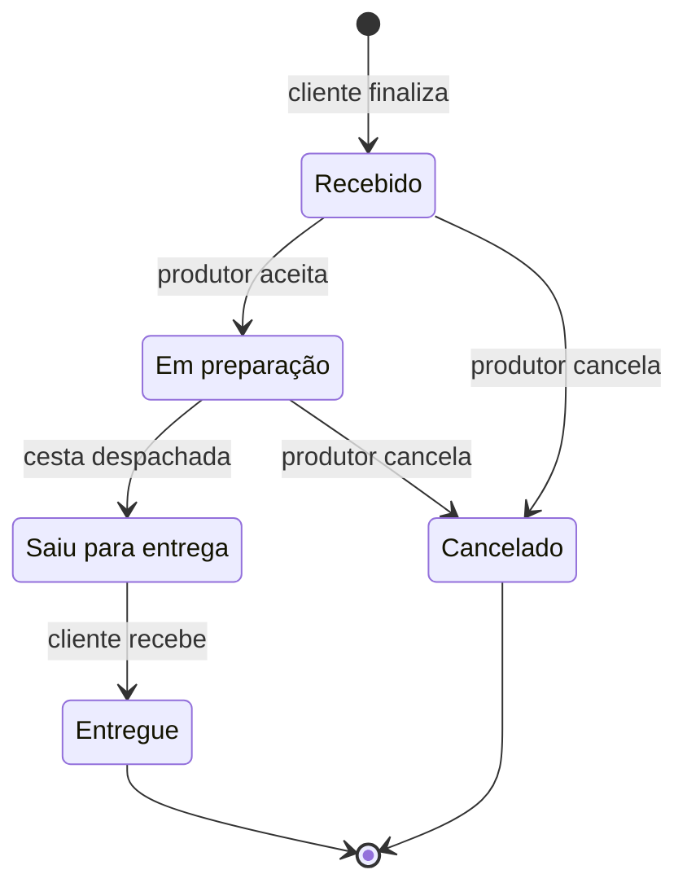

# Modelagem UML

Os diagramas estão em [Mermaid](https://mermaid.js.org/), renderizados automaticamente pelo GitHub.

## Diagrama de casos de uso

### Especificação do caso de uso principal — UC4 Finalizar pedido

| Item | Descrição |
|---|---|
| Ator | Cliente |
| Pré-condição | A cesta tem pelo menos um produto |
| Fluxo principal | 1. Cliente preenche nome, e-mail, telefone, endereço, cidade e CEP. 2. Cliente clica em *Finalizar pedido*. 3. Sistema valida os dados. 4. Sistema confere o estoque de cada item. 5. Sistema calcula subtotal, frete (UC5) e total com os preços do banco. 6. Sistema grava o pedido, desconta o estoque e gera o código. 7. Sistema exibe o código e o total. |
| Fluxo alternativo 3a | Dado inválido: sistema exibe a mensagem indicando o campo e mantém o formulário preenchido. |
| Fluxo alternativo 4a | Estoque insuficiente: sistema informa o produto e a quantidade disponível. |
| Pós-condição | Pedido gravado com estado *Recebido*; cesta esvaziada. |

## Diagrama de classes (persistência)

## Diagrama de sequência — Finalizar pedido

## Diagrama de atividades — Ciclo de vida do pedido

