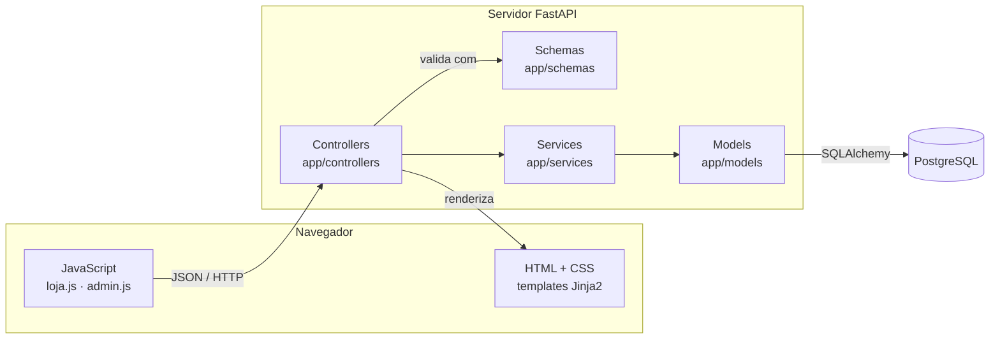

# Arquitetura

## Padrão MVC

| Camada | Pasta | Responsabilidade | Não deve |
|---|---|---|---|
| **Model** | `app/models/` | Representar as tabelas e relacionamentos | Conter regra de negócio ou lidar com HTTP |
| **View** | `app/views/` | Apresentar dados e capturar ações do usuário | Calcular preços ou decidir regras |
| **Controller** | `app/controllers/` | Receber a requisição, validar a entrada, chamar o service e devolver a resposta | Montar SQL ou calcular valores |
| Service | `app/services/` | Regras de negócio: frete, estoque, transições de estado, autenticação | Conhecer detalhes de HTTP |
| Schema | `app/schemas/` | Contratos de entrada e saída da API (Pydantic) | Acessar o banco |

A camada de *services* é uma extensão comum do MVC. Ela deixa os controllers finos e permite testar as regras de negócio isoladamente (`tests/test_servicos.py`).

## Fluxo de uma requisição: criar pedido

1. `loja.js` envia `POST /api/pedidos` com o cliente, o endereço e os itens (só `produto_id` e `quantidade`).
2. `pedido_controller.criar_pedido` recebe o corpo, já validado pelo schema `PedidoEntrada`. Erros de formato voltam como **422**.
3. `pedido_service.criar_pedido` busca os produtos no banco, confere o estoque, calcula os valores **com os preços do banco** e grava tudo numa transação.
4. Erros de regra (estoque, produto inexistente) sobem como `ErroDeNegocio` e o controller os converte em **400/404**.
5. O controller devolve o pedido no formato `PedidoSaida` com status **201**.

## Segurança

- Senha do administrador com **PBKDF2-SHA256**, 260 mil iterações e sal aleatório.
- Sessão em cookie assinado (`SessionMiddleware`) com expiração de 8 horas.
- Rotas `/api/admin/*` protegidas pela dependência `exigir_admin`.
- O navegador nunca envia preço: o total é sempre calculado no servidor.
- Toda saída de texto no front passa por `escaparHtml`, evitando injeção de HTML.
- Consultas feitas pelo SQLAlchemy com parâmetros (sem concatenar SQL).

## Configuração

Todas as configurações vêm de variáveis de ambiente (`.env`), lidas em `app/config.py`:

| Variável | Uso |
|---|---|
| `DATABASE_URL` | Conexão com o PostgreSQL |
| `TEST_DATABASE_URL` | Banco usado pelo `pytest` |
| `SECRET_KEY` | Assinatura do cookie de sessão |
| `ADMIN_EMAIL` / `ADMIN_PASSWORD` | Administrador criado pelo `init_db` |
