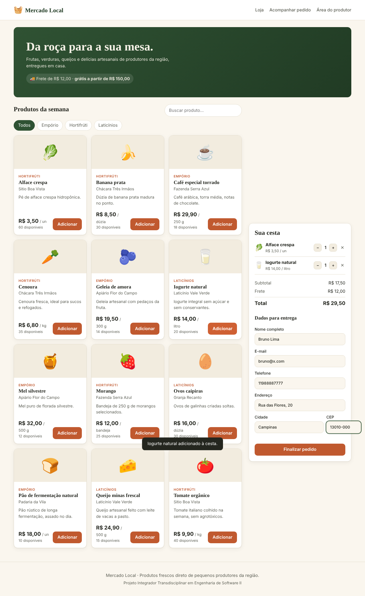
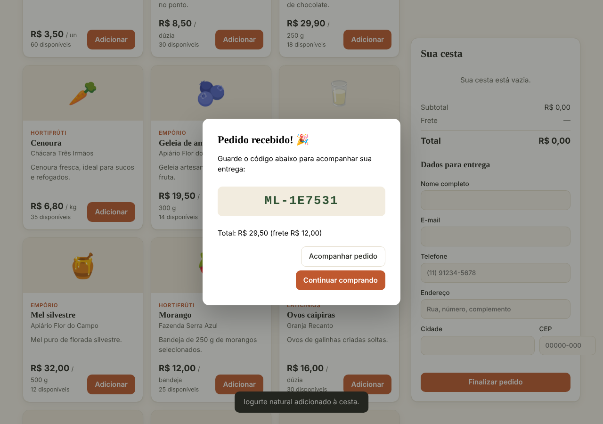
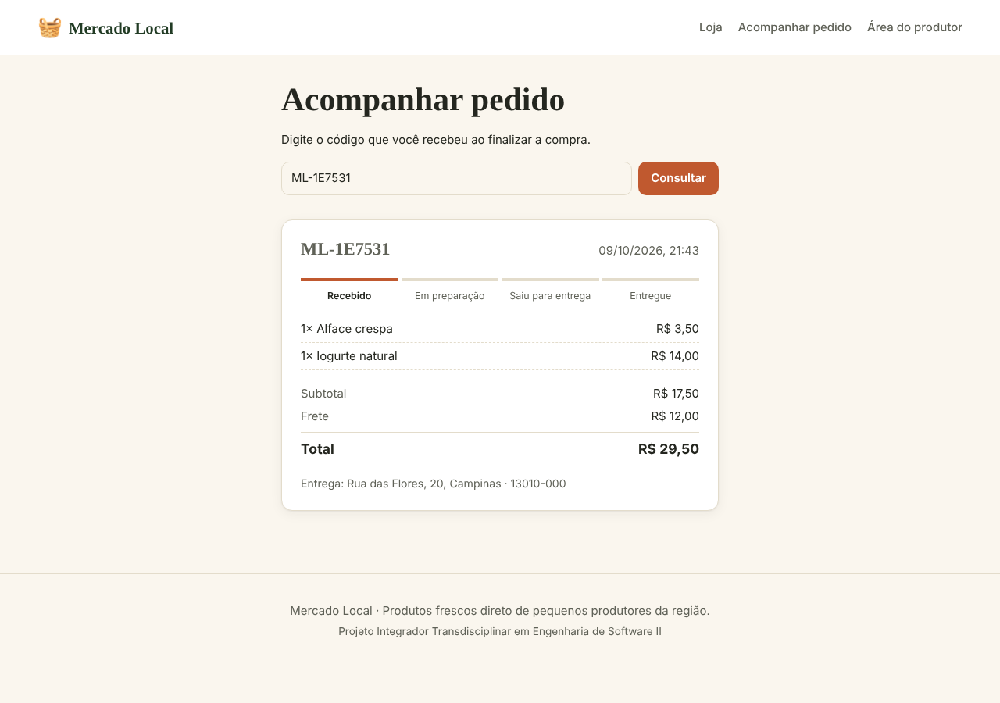
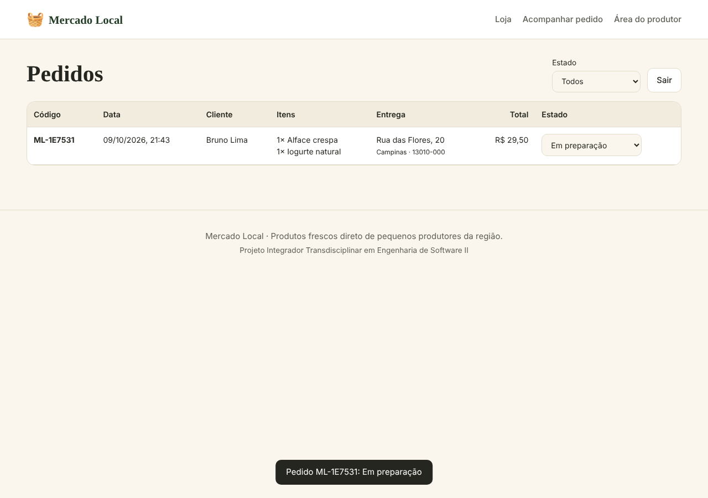

# Manual de uso

## Para o cliente

### 1. Escolher os produtos
1. Acesse a loja (página inicial).
2. Use a **busca** para encontrar um produto pelo nome, ou clique numa **categoria** (Hortifrúti, Laticínios, Empório) para filtrar.
3. Clique em **Adicionar** no produto desejado. Ele aparece em **Sua cesta**, à direita (no celular, abaixo dos produtos).

### 2. Ajustar a cesta
- **+** e **−** mudam a quantidade.
- **✕** remove o produto.
- O **resumo** mostra subtotal, frete e total. A partir de **R$ 150,00** o frete é grátis.
- Não é possível adicionar mais unidades do que o estoque disponível.

### 3. Finalizar o pedido
1. Preencha **nome, e-mail, telefone, endereço, cidade e CEP**.
2. Clique em **Finalizar pedido**.
3. Anote o **código do pedido** que aparece na confirmação (ex.: `ML-4F2A9C`).

O pagamento é feito na entrega.

### 4. Acompanhar a entrega
1. Clique em **Acompanhar pedido** no menu (ou no botão da confirmação).
2. Digite o código e clique em **Consultar**.
3. A linha do tempo mostra a etapa atual: Recebido → Em preparação → Saiu para entrega → Entregue.

## Para o produtor (administrador)

### 1. Entrar
1. Clique em **Área do produtor**.
2. Informe o e-mail e a senha de administrador e clique em **Entrar**.

### 2. Gerenciar pedidos
- A tabela mostra os pedidos do mais recente para o mais antigo, com cliente, itens, endereço e total.
- Use o filtro **Estado** para ver, por exemplo, só os pedidos *Recebidos*.
- Na coluna **Estado**, escolha a próxima etapa. Só aparecem as etapas permitidas:

| Estado atual | Pode ir para |
|---|---|
| Recebido | Em preparação, Cancelado |
| Em preparação | Saiu para entrega, Cancelado |
| Saiu para entrega | Entregue |
| Entregue / Cancelado | — (estados finais) |

### 3. Sair
Clique em **Sair**. A sessão também expira sozinha depois de 8 horas.

## Problemas comuns

| Problema | Solução |
|---|---|
| "Estoque insuficiente" ao finalizar | Outro cliente comprou antes; diminua a quantidade do produto indicado. |
| "Pedido não encontrado" | Confira o código: começa com `ML-` seguido de 6 letras/números. |
| A página não carrega os produtos | Verifique se o servidor e o banco (Docker) estão rodando. |
